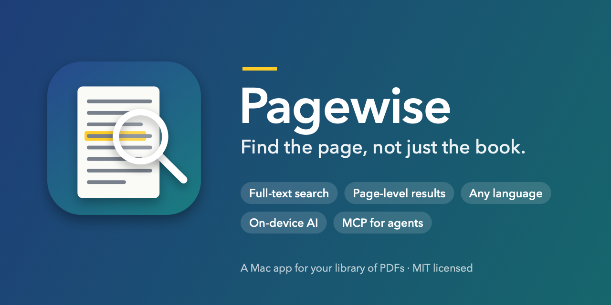

# Pagewise

**A knowledge base you can trust: built by you, with help from AI, and used by any AI.**

Pagewise is a free Mac app (beta) for your library: PDFs and EPUB books, Markdown and text files, photos, recordings and videos.

- **Search inside every page**, and every transcript, in any language. One click opens the document at the right page or moment, with your words highlighted.
- **Write notes as you read, watch and listen.** A note sits beside its passage, or at its moment on a recording or a video, where it can keep the frame. Write in words, math, a sketch, a picture or your own voice.
- **Explain ideas in your own words.** Every sentence cites a note, every note leads back to its source, and a map shows how your ideas connect and where your understanding is still thin.
- **AI helps, you decide.** AI can file new documents and point you to passages with a question, as a card. It never writes your notes.
- **Used by any AI.** AI apps that speak MCP can read your notes and explanations and cite the exact page, served from your Mac.
- **On your phone**: read, search and write notes from anywhere, privately through your Mac.

Your documents, notes and search index stay in a folder on your Mac. No account, no analytics, no tracking.

## This repository

It holds the Pagewise website and the free beta downloads. The app's source code is not published here.

- Website, with a short video introduction: https://xxln.github.io/pagewise-app/
- Download (free beta, macOS 14 or later, Apple silicon and Intel): [Releases](https://github.com/xxln/pagewise-app/releases)
- Report a problem or suggest something: [Issues](https://github.com/xxln/pagewise-app/issues)
- Privacy: https://xxln.github.io/pagewise-app/privacy.html

The beta is not yet notarized by Apple: the first time you open it, macOS asks you to confirm once. The steps are on the website under *Install*.

© 2026 Xiulin Xu. All rights reserved.
